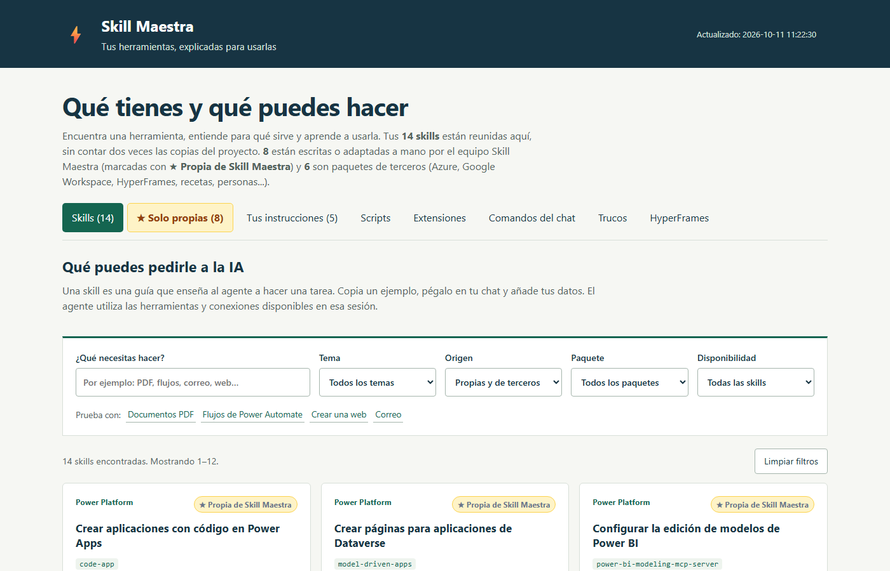

# Skill Maestra

[](LICENSE)
[](#cómo-empezar)
[](#qué-incluye)
[](#)

Cuadro de mandos local, en español, para gestionar tus herramientas de IA en VS Code: skills, comandos del chat, extensiones, trucos de Claude Code y las instrucciones que siguen los agentes (Claude, Codex, Copilot).



## Por qué existe

Cuando empiezas a usar agentes de IA en serio acumulas decenas de skills, comandos y extensiones, cada una con su nombre técnico y su README en inglés. Al poco tiempo ya no recuerdas qué tienes ni para qué sirve. Skill Maestra nace de esa necesidad: una web local que lo lista todo, lo explica en lenguaje llano y te da un ejemplo listo para pegar en el chat. La hice para mi propio trabajo diario y la comparto por si te ahorra el mismo camino.

Todo es HTML estático más un script de PowerShell que regenera el catálogo leyendo las skills instaladas. No necesita cuenta, servidor ni dependencias.

## Qué incluye

- **Catálogo de skills** (`index.html`): una ficha por skill con nombre en lenguaje llano, para qué sirve y un ejemplo listo para copiar al chat. Se regenera automáticamente.
- **Comandos del chat** (`comandos.html`): referencia de comandos y ajustes de Claude Code, Codex y Copilot.
- **Trucos** (`trucos.html`): trucos de Claude Code, dictado, VS Code y Windows.
- **Extensiones** (`extensiones.html`): inventario explicado de extensiones de VS Code.
- **Guía de HyperFrames** (`hyperframes.html`): cómo usar las skills de HyperFrames para crear vídeo.
- **Skills** (`.github/skills/`): skills propias (crear skills, buscar skills, personalizar agentes, documentar diseño...) y algunas de terceros con su licencia.
- **Scripts**: regenerar el catálogo, sincronizar skills a la carpeta global del usuario y abrir la web.
- **Extensión de VS Code** (`.vscode/skill-maestra-viewer/`): abre el cuadro de mandos en una pestaña al abrir el proyecto.

## Cómo empezar

Requisitos: Windows con PowerShell (5.1 o 7) y VS Code. Opcional: extensión **Live Preview** (`ms-vscode.live-server`).

```powershell
git clone https://github.com/informaticolorenzo/skill-maestra-public.git
cd skill-maestra-public

# Regenerar el catálogo con las skills del repositorio y las de tu carpeta global (~/.agents/skills)
pwsh -File _archivos_por_categoria\scripts\ps1\Update-SkillMaestraWebIndex.ps1

# Abrir la web (levanta un servidor local en el puerto 8000)
.\open-skill-maestra-web.ps1
```

También puedes abrir `_archivos_por_categoria/web/html/index.html` con Live Preview desde VS Code. Al abrir la carpeta, la tarea `folderOpen` de `.vscode/tasks.json` lo hace sola.

## Cómo funciona el catálogo

`Update-SkillMaestraWebIndex.ps1` lee:

- `.github/skills/*/SKILL.md` (skills del proyecto);
- `~/.agents/skills` y `~/.claude/skills` (skills globales del usuario, si existen);
- `.github/copilot-instructions.md` (instrucciones a la IA, una ficha por sección).

Y escribe solo la parte de `index.html` entre `<!-- AUTO-INDEX-SKILL-MAESTRA:START -->` y `:END`, además de `web/md/catalogo-skills.md`. El resto del HTML se mantiene a mano.

Los nombres y descripciones en español salen de `_archivos_por_categoria/web/data/skill-descriptions.es.tsv`. Una skill sin fila ahí aparece con su nombre técnico y la descripción original.

## Añadir tus skills

1. Crea la skill: `pwsh -File .github\skills\skill-creator\scripts\new-skill-scaffold.ps1 -SkillName mi-skill`
2. Añade su fila al TSV.
3. Regenera el catálogo.
4. Opcional: `pwsh -File shared\scripts\sync-global-skills.ps1 -WhatIf` para ver cómo quedaría la copia en `~/.agents/skills` (sin `-WhatIf` borra y vuelve a copiar cada skill del proyecto).

## Extensión de VS Code

El código está en `.vscode/skill-maestra-viewer/`. Para empaquetarla e instalarla:

```powershell
npm install -g @vscode/vsce
cd .vscode\skill-maestra-viewer
vsce package
code --install-extension .\skill-maestra-viewer-0.0.4.vsix --force
```

Solo se activa en workspaces que contengan `_archivos_por_categoria/web/html/index.html`.

## Estructura

```
.github/skills/                 skills (una carpeta por skill)
.github/copilot-instructions.md instrucciones a la IA (ejemplo)
_archivos_por_categoria/web/    html, css, js, datos y catálogo markdown
_archivos_por_categoria/scripts/ps1/Update-SkillMaestraWebIndex.ps1
shared/scripts/sync-global-skills.ps1
open-skill-maestra-web.ps1
.vscode/                        tarea folderOpen y extensión viewer
```

## Licencia

MIT para el código y contenido propio. Las skills de terceros conservan su licencia en el `LICENSE.txt` de cada carpeta.

## Cómo contribuir

Las propuestas son bienvenidas: una skill nueva, un truco, una corrección del catálogo. Lee [CONTRIBUTING.md](CONTRIBUTING.md) para ver cómo enviarlas y [CODE_OF_CONDUCT.md](CODE_OF_CONDUCT.md) para las normas de convivencia. Para avisar de un problema de seguridad, sigue [SECURITY.md](SECURITY.md).

## Autor

**Lorenzo Martín Ramírez** · Desarrollador especializado en soluciones low code (Power Platform, Velneo) y en el uso de agentes de IA en el trabajo diario. Granada, España.

- GitHub: [@informaticolorenzo](https://github.com/informaticolorenzo)
- LinkedIn: [lorenzo-martin-low-code](https://www.linkedin.com/in/lorenzo-martin-low-code)

Si el proyecto te resulta útil, una estrella ⭐ en GitHub ayuda a que lo encuentre más gente.
